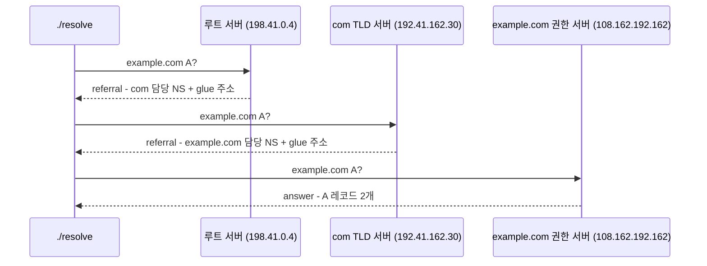

# DNS 리졸버

도메인 이름(예: `example.com`)을 IP 주소로 바꾸는 과정을 루트 네임서버부터 직접 따라가는 C 프로그램.

> 토이 4번. 언어: C. 리졸버 라이브러리 없이 POSIX 소켓/시간 API만 사용.

## 왜 만들었나

보통 프로그램은 `getaddrinfo` 같은 OS 함수에 이름 조회를 맡긴다. 이 프로젝트는 그 함수를 쓰지 않고, DNS 쿼리 패킷을 바이트 단위로 직접 조립해 UDP로 보내고 응답도 직접 파싱한다 (`getaddrinfo`, `res_query` 등 금지).

- ft_irc/webserv는 텍스트 프로토콜 - 바이너리 프로토콜 파싱은 미개척
- LedgerTCP로 소켓은 익숙하니 프로토콜 자체에 집중 가능
- 압축 포인터 파싱이 별미 - 오프셋 점프하는 바이너리 포맷

다루는 CS 지식: 네트워크 바이너리 프로토콜 파싱, 반복 질의(RFC 1034 §5.3.3), 압축 포인터(RFC 1035 §4.1.4), TTL 캐싱.

## 주요 기능

- **반복(iterative) 질의** - 루트 서버에서 시작해 TLD(`.com` 같은 최상위 도메인) 서버, 권한(authoritative) 서버 순으로 직접 내려간다
- **CNAME 체이싱** - 답이 별칭(CNAME)이면 실제 이름으로 다시 해석한다
- **TTL 캐시** - 받은 레코드를 유효 시간(TTL) 동안 저장하고, 다음 해석은 캐시된 가장 가까운 존에서 시작한다
- **안전한 파싱** - 모든 읽기를 경계 검사하고, 압축 포인터 루프를 막는다
- **dig 스타일 출력** - 최종 레코드는 stdout에 `dig +short` 형식으로, 위임 경로는 stderr에 출력한다
- 레코드 타입: A, AAAA, NS

## 동작 방식

`example.com` A 레코드를 찾을 때의 흐름 (아래 [사용](#사용)의 실제 실행 결과와 같은 경로):



- **referral(위임)** - "나는 모르지만 이 서버들에게 물어봐라"는 응답. authority 섹션에 다음 NS 이름이, additional 섹션에 그 NS의 IP(glue)가 실린다
- 리졸버는 referral을 받을 때마다 다음 서버로 내려가고, answer를 받으면 멈춘다
- answer가 CNAME이면 타깃 이름으로 같은 과정을 처음부터 반복한다 (캐시가 있으면 루트를 건너뜀)

## 빠른 시작

```bash
make                       # ./resolve 생성 (-Wall -Wextra, 경고 0)
./resolve example.com
```

## 사용

```bash
./resolve [-t A|AAAA|NS] [-v] <domain> [<domain>...]
```

| 옵션 | 설명 |
|------|------|
| `-t TYPE` | 레코드 타입: A(기본), AAAA, NS |
| `-v` | 캐시 히트와 모든 네트워크 쿼리를 stderr에 로그 |

도메인 여러 개를 넘기면 한 프로세스 안에서 캐시가 이어진다. 모든 도메인이 레코드로 풀려야 exit 0.

실제 실행 예 (경로는 stderr, 답은 stdout):

```
$ ./resolve example.com
; resolving example.com type A
  @198.41.0.4 (.) example.com 1 -> referral to com [13 ns, 6 addrs]
  @192.41.162.30 (com) example.com 1 -> referral to example.com [2 ns, 6 addrs]
  @108.162.192.162 (example.com) example.com 1 -> answer (2 records)
104.20.23.154
172.66.147.243
```

CNAME 체이싱 예 (www.iana.org는 cloudflare.net CDN으로 CNAME):

```
$ ./resolve www.iana.org
; resolving www.iana.org type A
  @198.41.0.4 (.) www.iana.org 1 -> referral to org [6 ns, 6 addrs]
  @199.249.112.1 (org) www.iana.org 1 -> referral to iana.org [4 ns, 1 addrs]
  @199.4.138.53 (iana.org) www.iana.org 1 -> answer (1 records)
  www.iana.org CNAME -> www.iana.org.cdn.cloudflare.net
  @198.41.0.4 (.) www.iana.org.cdn.cloudflare.net 1 -> referral to net [13 ns, 6 addrs]
  @192.55.83.30 (net) www.iana.org.cdn.cloudflare.net 1 -> referral to cloudflare.net [5 ns, 9 addrs]
  @108.162.198.250 (cloudflare.net) www.iana.org.cdn.cloudflare.net 1 -> answer (2 records)
104.18.24.232
104.18.25.232
```

## 테스트

```bash
make test                    # 오프라인 단위 테스트 3종, AddressSanitizer 빌드
bash tests/compare_dig.sh    # ./resolve 결과를 dig +short와 집합 비교 (네트워크/dig 필요)
```

`make test` 결과 (3종 모두 ALL PASS):

| 테스트 | checks | 내용 |
|--------|--------|------|
| `test_message` | 16 | 쿼리 인코딩 + 응답 디코딩, 압축 포인터 경계/루프 케이스 |
| `test_cache` | 7 | TTL 만료, 대소문자 무시 매칭, TTL 0 미저장, 타입 불일치 |
| `test_cname` | 4 | 캐시만으로 CNAME 체인 종결 (네트워크 없이 `resolve()` 구동) |

`compare_dig.sh`는 고정 도메인 목록(A/AAAA/NS)에 대해 IP/NS 집합을 순서와 TTL 무시하고 비교한다. dig가 없으면 SKIP.

## 내부 설계

| 모듈 | 파일 | 핵심 |
|------|------|------|
| 반복 질의 | `src/resolve.c` | 루트 힌트에서 NS 위임을 따라 내려감 |
| CNAME 체이싱 | `src/resolve.c` | 타깃 이름으로 해석 재시작 |
| 메시지 인코딩/디코딩 | `src/dns_encode.c`, `src/dns_decode.c` | 패킷 조립, 압축 포인터 파싱 |
| UDP 전송 | `src/dns_query.c` | 포트 53, 타임아웃/재시도 |
| TTL 캐시 | `src/cache.c` | 고정 슬롯, 만료 관리 |
| 루트 힌트 | `src/root_hints.c` | 하드코딩된 루트 서버 IPv4 8개 |
| CLI | `src/main.c` | 옵션 파싱, stdout/stderr 출력 |

세부 동작:

- **반복 질의** - 루트 힌트에서 시작해 authority 섹션의 NS 위임을 따라 내려간다. glue A는 additional 섹션에서 줍고, glue 없는 NS는 제한된 깊이(8)의 서브 해석으로 직접 푼다. 위임 홉 32회 제한. 서버가 응답하지 않으면 목록의 다음 서버로 폴백
- **CNAME 체이싱** - 체인 8회 제한. 같은 응답에 타깃 레코드가 이미 실려 있으면 바로 사용. NS 질의는 CNAME을 따라가지 않음
- **압축 포인터 파싱** - DNS는 같은 이름을 반복하지 않으려고 "앞쪽 오프셋을 가리키는 포인터"를 쓴다. 포인터는 엄격히 뒤쪽만 가리킬 수 있고 점프 횟수에 상한이 있어 파싱이 항상 종료됨
- **TTL 캐시** - 고정 8192 슬롯 선형 탐색. 만료 레코드는 절대 반환 안 함, TTL 0은 저장 안 함, 가득 차면 가장 먼저 만료될 항목 축출. 응답의 모든 A/AAAA/NS/CNAME을 캐싱하고, 다음 해석은 캐시된 가장 가까운 위임 존에서 시작 (루트 재방문 생략)
- **UDP 전송** - IPv4 UDP 포트 53, 512바이트 패킷. 트랜잭션 ID 불일치 응답은 버리고 데드라인까지 대기. 쿼리당 3초 타임아웃 + 1회 재시도. TC=1(응답 잘림) truncation은 최종 답에서는 에러 처리, referral에서는 허용 (포함된 레코드는 완전하므로)

## 프로젝트 구조

```
dns-resolver/
├── Makefile
├── src/          # 리졸버 소스 (main, resolve, dns_query, dns_encode/decode, cache, root_hints)
├── tests/        # 단위 테스트 3종 + compare_dig.sh
└── .planning/    # SPEC.md, 단계별 plans
```

## 문서

- [docs/SRS.md](docs/SRS.md) - 요구사항 명세
- [docs/SDS.md](docs/SDS.md) - 설계 명세: 구성도, 시퀀스, ERD/자료구조, 모듈
- [SPEC](.planning/SPEC.md) - 원본 명세 (요구사항 R1-R7, 범위, must-NOT)
- [plans](.planning/plans/) - 단계별 구현 계획 (메시지, UDP, 반복 질의, CNAME, 캐시/CLI)

## 확장 (선택)

- EDNS0, TCP 폴백 (512바이트 초과 응답)
- 미니 Redis(토이 5번)의 캐시 백엔드로 연결 가능
