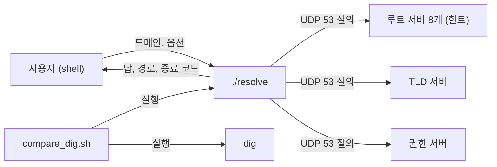
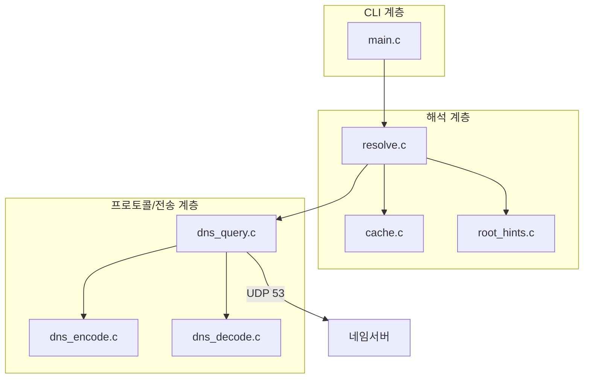
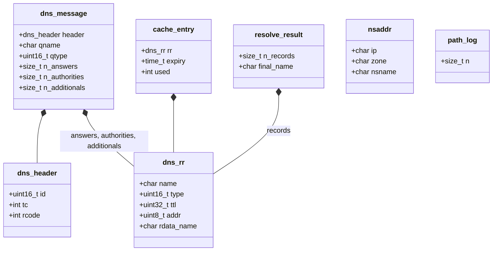
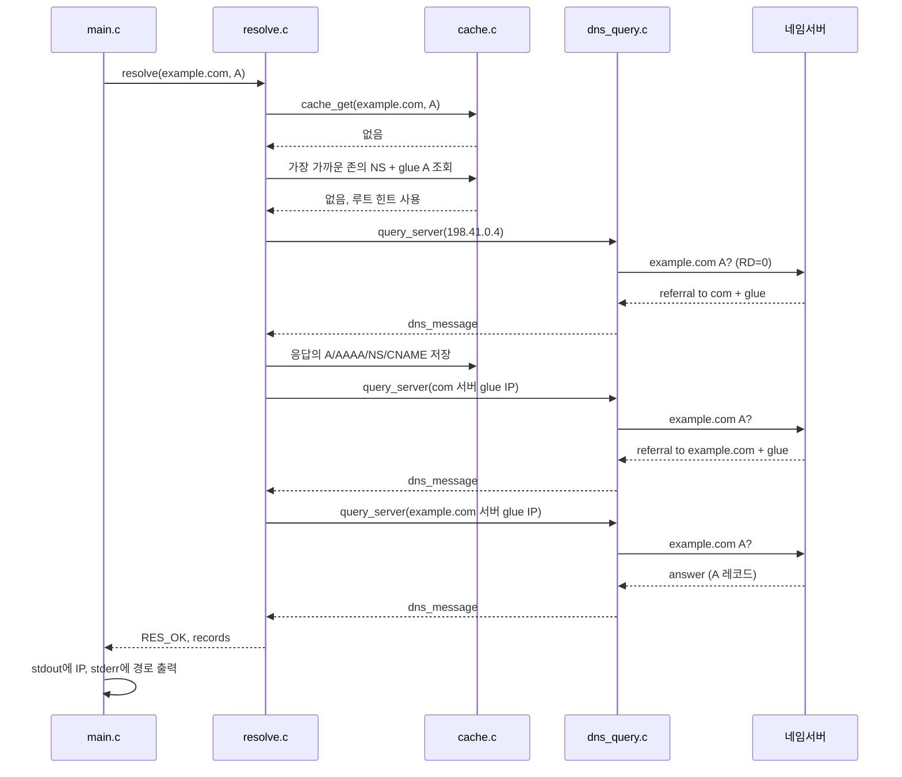
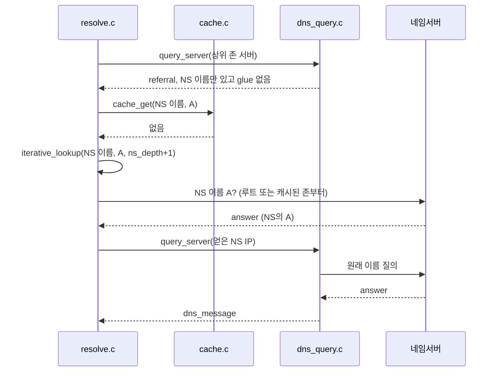
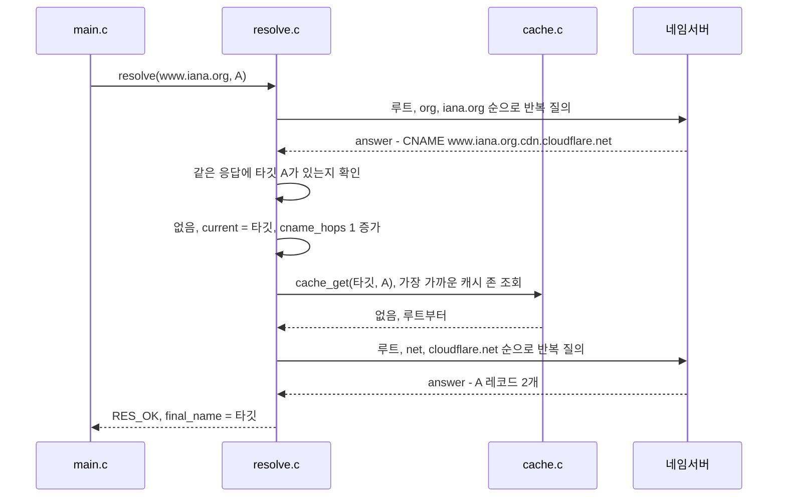
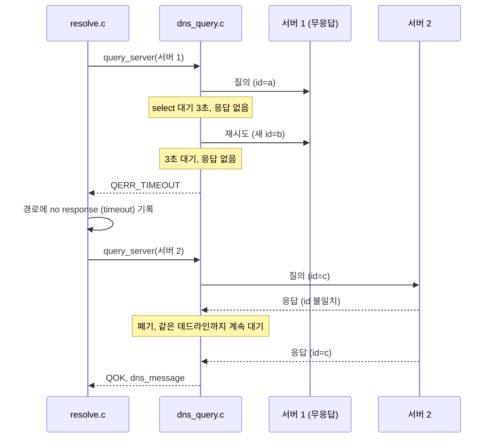
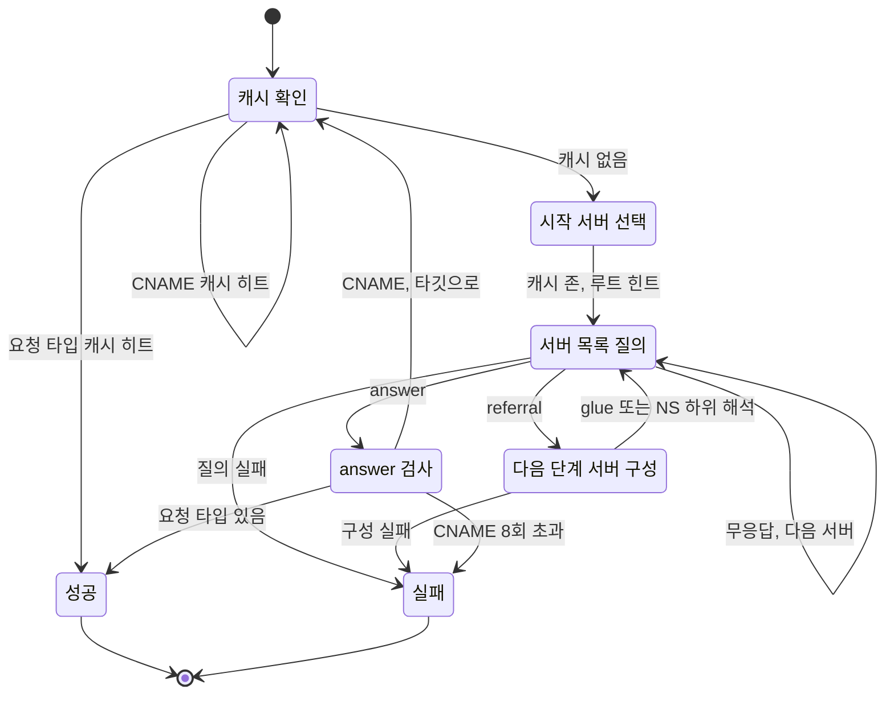
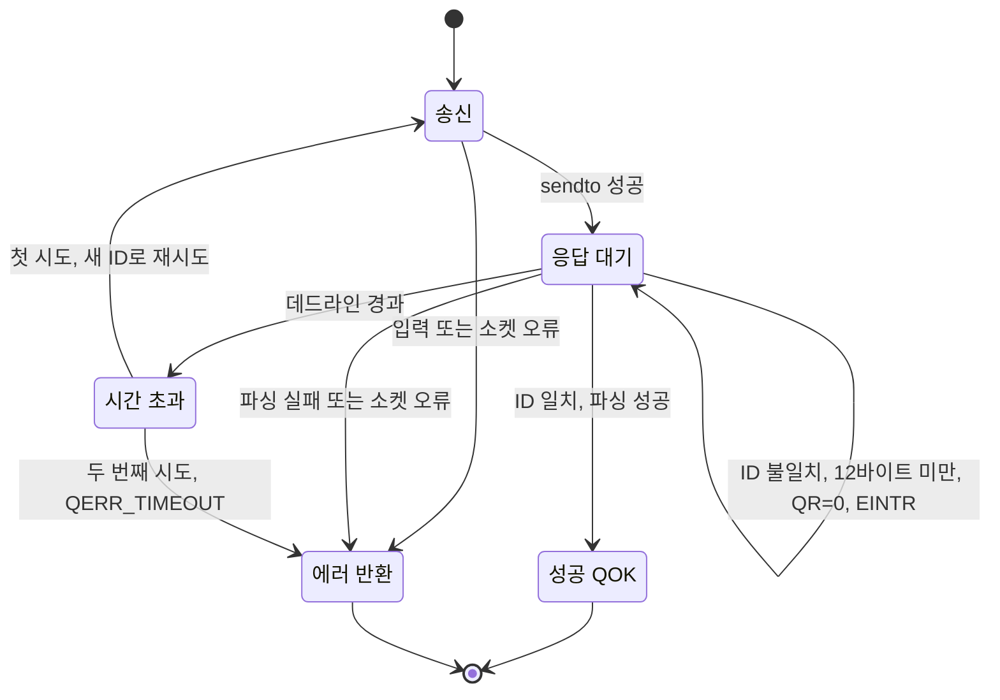
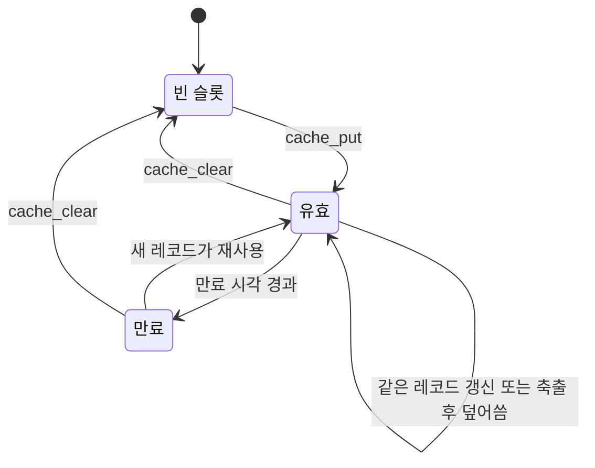

# DNS 리졸버 소프트웨어 설계 명세서 (SDS)

| 문서 | 버전 | 작성일 | 기준 표준 |
|------|------|--------|-----------|
| DNS 리졸버 SDS | 1.0 | 2026-11-18 | IEEE 1016-2009 |

## 1. 소개

### 1.1 목적

이 문서는 반복형 DNS 리졸버 `./resolve`의 설계를 설명한다. 구성 요소, 자료구조와 와이어 포맷, 상호작용, 상태, 알고리즘, 설계 근거를 다루며 [SRS](SRS.md)의 각 요구사항이 어느 설계 요소에서 구현되는지 추적한다.

### 1.2 범위

`src/`의 C 소스 전체(CLI, 반복 해석, CNAME 체이싱, UDP 전송, 메시지 인코딩/디코딩, TTL 캐시, 루트 힌트)와 `tests/`의 테스트를 대상으로 한다. 범위 밖 기능(EDNS0, TCP 폴백, DNSSEC 등)은 [SRS 부록 B](SRS.md#부록-b-범위-외-항목)를 따른다.

### 1.3 용어 정의

[SRS 1.4 용어 정의](SRS.md#14-용어-정의)를 따른다. 이 문서에서 추가로 쓰는 용어:

| 용어 | 뜻 |
|------|----|
| 서버 목록 | 현재 단계에서 질의할 네임서버 IP 배열 (`nsaddr[]`) |
| 홉 | referral 하나를 따라 한 단계 내려가는 것 |
| 데드라인 | 질의 시도 하나가 응답을 기다리는 절대 시각 (보낸 시각 + 3초) |

### 1.4 참고 문서

| 문서 | 내용 |
|------|------|
| [SRS](SRS.md) | 요구사항 명세 |
| [README](../README.md) | 개요, 사용법, 실행 예 |
| RFC 1034 §5.3.3 | 리졸버 알고리즘 |
| RFC 1035 §4, §4.1.4 | 메시지 포맷, 압축 포인터 |
| RFC 3596 | AAAA 레코드 |

## 2. 설계 이해관계자와 관심사

| 이해관계자 | 관심사 | 다루는 뷰 |
|------------|--------|-----------|
| 사용자 (CLI 실행자) | 사용법, 출력 형식, 종료 코드 | 3.1 컨텍스트, 3.5 인터페이스 |
| 개발자 | 모듈 경계, 자료구조, 해석 알고리즘 | 3.2 구성, 3.3 논리, 3.4 정보, 3.8 알고리즘 |
| 코드 리뷰어 | 파싱 안전성(경계 검사, 포인터 루프), 유한 종료 보장 | 3.4 정보, 3.7 상태 동적, 5 오류 처리 |
| 테스트 작성자 | 오프라인 시험 지점, 시각 주입 | 3.6 상호작용, 3.9 자원, 6 추적 |

## 3. 설계 뷰

### 3.1 컨텍스트 뷰

`./resolve`를 블랙박스로 보면 입력은 명령행 인자, 출력은 stdout/stderr와 종료 코드, 외부 시스템은 인터넷의 DNS 네임서버뿐이다.



| 외부 요소 | 관계 |
|-----------|------|
| 사용자 | 인자를 주고 stdout(답), stderr(경로/에러), 종료 코드를 받는다 |
| 루트/TLD/권한 서버 | RD=0 질의를 받고 referral 또는 answer를 돌려준다 |
| `tests/compare_dig.sh`, `dig` | 시험용. 같은 도메인의 결과 집합을 비교한다 |

### 3.2 구성 뷰



| 구성 요소 | 역할 | 기술 |
|-----------|------|------|
| `main.c` | 옵션 파싱, 도메인별 `resolve()` 호출, 결과/경로 출력, 종료 코드 결정 | C11, stdio |
| `resolve.c` | 서버 목록 선택(캐시 또는 루트), referral 추적, glue-less NS 해석, CNAME 체이싱, 경로 기록 | C11 |
| `cache.c` | (이름, 타입) 키로 레코드와 만료 시각 저장, 만료 엔트리 제외 조회 | 정적 배열 8192 슬롯, 선형 탐색 |
| `root_hints.c` | 루트 서버 이름과 IPv4 주소 8개 | 정적 상수 배열 |
| `dns_query.c` | UDP 송수신, 데드라인 기반 대기, 트랜잭션 ID 검증, 재시도 | POSIX `socket`, `sendto`, `recvfrom`, `select` |
| `dns_encode.c` | 헤더 + QNAME + QTYPE + QCLASS 직렬화 | 바이트 직접 기록 (`put16`) |
| `dns_decode.c` | 헤더, 질문, 세 섹션의 레코드 파싱, 압축 포인터 처리 | 경계 검사 헬퍼 `read16`, `read32` |

모듈 상세:

| 모듈/파일 | 책임 | 주요 함수/구조체 |
|-----------|------|------------------|
| `src/main.c` | CLI 파싱, 출력, 종료 코드 | `main`, `usage`, `parse_type`, `type_name`, `print_record` |
| `src/resolve.c`, `src/resolve.h` | 반복 해석, CNAME 체이싱, 캐시 활용, 경로 기록 | `resolve`, `iterative_lookup`, `resolve_ns_ip`, `servers_from_cache`, `servers_from_root`, `cache_message`, `answer_has_useful`, `collect_answers`, `find_cname`, `path_add`, `res_status_str` |
| `src/dns_query.c`, `src/dns_query.h` | UDP 질의 1회와 재시도, ID 검증 | `query_server`, `query_once`, `random_id`, `now_sec`, `g_verbose` |
| `src/dns_encode.c` | 질의 패킷 직렬화 | `dns_build_query`, `dns_encode_name` |
| `src/dns_decode.c` | 응답 패킷 파싱 | `dns_parse_message`, `dns_decode_name`, `parse_section`, `parse_rr` |
| `src/dns_message.h` | 와이어 포맷 상수와 구조체 | `dns_header`, `dns_rr`, `dns_message` |
| `src/cache.c`, `src/cache.h` | TTL 캐시 | `cache_put`, `cache_put_at`, `cache_get`, `cache_get_at`, `cache_clear` |
| `src/root_hints.c`, `src/root_hints.h` | 루트 힌트 | `root_hint`, `ROOT_HINTS`, `ROOT_HINTS_COUNT` |

### 3.3 논리 뷰



| 구조체 | 소유 모듈 | 생성 위치 | 수명 |
|--------|-----------|-----------|------|
| `dns_message` | `dns_message.h` | `dns_parse_message`가 채움, `iterative_lookup` 스택 | 홉 하나 |
| `dns_rr` | `dns_message.h` | 파서, 캐시, 결과에 값으로 복사 | 소유 구조체를 따름 |
| `cache_entry` | `cache.c` | 정적 전역 `g_cache[8192]` | 프로세스 |
| `nsaddr` | `resolve.c` | `servers_from_root`, `servers_from_cache`, referral 처리 | 홉 하나 |
| `resolve_result`, `path_log` | `resolve.h` | `main`이 도메인마다 스택에 할당 | 도메인 하나 |
| `root_hint` | `root_hints.h` | 정적 상수 | 프로세스 |

### 3.4 정보 뷰

DB는 없다. 핵심 데이터는 DNS 와이어 포맷, 그것을 담는 C 구조체, 캐시 엔트리다. 모든 버퍼는 고정 크기이고 동적 할당은 없다.

#### 3.4.1 메시지 구성 (RFC 1035 §4)

| 섹션 | 내용 |
|------|------|
| Header | 12바이트 고정 |
| Question | QNAME + QTYPE(2) + QCLASS(2), `QDCOUNT`개. 첫 질문만 저장 |
| Answer | RR `ANCOUNT`개 |
| Authority | RR `NSCOUNT`개 (referral의 NS) |
| Additional | RR `ARCOUNT`개 (glue) |

#### 3.4.2 Header 바이트 배치 (big-endian)

| 오프셋 | 크기 | 필드 | 질의 시 값 |
|--------|------|------|-----------|
| 0 | 2 | ID | `rand()` 16비트 |
| 2 | 2 | Flags | `0x0000` (QR=0, opcode=0, RD=0) |
| 4 | 2 | QDCOUNT | 1 |
| 6 | 2 | ANCOUNT | 0 |
| 8 | 2 | NSCOUNT | 0 |
| 10 | 2 | ARCOUNT | 0 |

Flags 비트:

| 비트 | 필드 | 뜻 |
|------|------|----|
| 15 | QR | 1이면 응답 |
| 14-11 | Opcode | 0 = 표준 질의 |
| 10 | AA | 권한 응답 |
| 9 | TC | 잘린 응답 |
| 8 | RD | 재귀 요청 (항상 0으로 보냄) |
| 7 | RA | 재귀 가능 |
| 6-4 | Z | 예약 (파싱하지 않음) |
| 3-0 | RCODE | 0 NOERROR, 1 FORMERR, 2 SERVFAIL, 3 NXDOMAIN |

#### 3.4.3 Resource record 배치

| 필드 | 크기 | 설명 |
|------|------|------|
| NAME | 가변 | 레이블 또는 압축 포인터 |
| TYPE | 2 | A=1, NS=2, CNAME=5, AAAA=28 |
| CLASS | 2 | IN=1 |
| TTL | 4 | 초 |
| RDLENGTH | 2 | RDATA 길이 |
| RDATA | RDLENGTH | A는 4바이트, AAAA는 16바이트, NS/CNAME은 (압축 가능한) 이름. 그 외 타입은 건너뜀 |

#### 3.4.4 이름 인코딩과 압축 포인터

| 첫 바이트 상위 2비트 | 의미 | 처리 |
|---------------------|------|------|
| `00` | 레이블 길이 (0-63) | 길이 0이면 이름 끝. 예: `example.com` = `07 example 03 com 00` |
| `11` | 압축 포인터 | 하위 14비트가 패킷 내 오프셋. 현재 위치보다 앞쪽만 허용, 점프 128회 상한 |
| `01`, `10` | 예약 | 에러 |

첫 포인터를 만나면 원래 스트림의 다음 읽기 위치는 그 포인터 2바이트 바로 뒤가 된다.

#### 3.4.5 상수

| 상수 | 값 | 정의 위치 | 용도 |
|------|----|-----------|------|
| `DNS_MAX_NAME` | 256 | `dns_message.h` | 이름 버퍼 (NUL 포함, 와이어 최대 255) |
| `DNS_MAX_LABEL` | 63 | `dns_message.h` | 레이블 최대 길이 |
| `DNS_MAX_PACKET` | 512 | `dns_message.h` | 송수신 버퍼 (EDNS0 없음) |
| `DNS_MAX_JUMPS` | 128 | `dns_message.h` | 압축 포인터 점프 상한 |
| `DNS_MAX_RECORDS` | 64 | `dns_message.h` | 섹션당 레코드 수 상한 |
| `QUERY_TIMEOUT_SEC` | 3 | `dns_query.h` | 시도당 타임아웃 |
| `QUERY_RETRIES` | 1 | `dns_query.h` | 재시도 횟수 (총 2회 시도) |
| `MAX_SERVERS` | 32 | `resolve.c` | 한 단계 서버 목록 크기 |
| `MAX_DELEGATIONS` | 32 | `resolve.c` | 위임 홉 상한 |
| `MAX_NS_DEPTH` | 8 | `resolve.c` | glue-less NS 재귀 깊이 상한 |
| `MAX_CNAME` | 8 | `resolve.c` | CNAME 체인 상한 |
| `CACHE_CAP` | 8192 | `cache.c` | 캐시 슬롯 수 |
| `PATH_MAX_LINES` / `PATH_LINE_LEN` | 512 / 200 | `resolve.h` | 경로 로그 크기 |

#### 3.4.6 구조체 필드

| 구조체 | 필드 | 설명 |
|--------|------|------|
| `dns_header` | `uint16_t id` | 트랜잭션 ID |
| | `int qr, opcode, aa, tc, rd, ra, rcode` | 플래그 비트를 풀어 둔 값 |
| | `uint16_t qdcount, ancount, nscount, arcount` | 섹션별 개수 |
| `dns_rr` | `char name[256]` | 소유자 이름 (점 표기, 압축 해제됨) |
| | `uint16_t type, rr_class` | 타입, 클래스 |
| | `uint32_t ttl` | TTL (초) |
| | `uint16_t rdlength` | RDATA 길이 |
| | `uint8_t addr[16]` | A(4바이트) 또는 AAAA(16바이트) 주소 |
| | `char rdata_name[256]` | NS / CNAME 타깃 이름 |
| `dns_message` | `dns_header header` | 헤더 |
| | `char qname[256]`, `uint16_t qtype, qclass` | 첫 질문 |
| | `dns_rr answers[64]`, `size_t n_answers` | answer 섹션 |
| | `dns_rr authorities[64]`, `size_t n_authorities` | authority 섹션 |
| | `dns_rr additionals[64]`, `size_t n_additionals` | additional 섹션 |
| `cache_entry` | `dns_rr rr` | 저장된 레코드 |
| | `time_t expiry` | 절대 만료 시각 = 저장 시각 + TTL |
| | `int used` | 슬롯 사용 여부 |
| `nsaddr` | `char ip[46]` | 질의할 서버 IP |
| | `char zone[256]` | 이 서버가 담당하는 존 (경로 출력용) |
| | `char nsname[256]` | NS 이름 |
| `resolve_result` | `dns_rr records[64]`, `size_t n_records` | 최종 레코드 |
| | `char final_name[256]` | CNAME 체이싱 후 최종 이름 |
| `path_log` | `char lines[512][200]`, `size_t n` | 단계별 경로 한 줄씩 |
| `root_hint` | `const char *name, *ipv4` | 루트 서버 이름과 IPv4 |

#### 3.4.7 캐시 규칙

| 동작 | 규칙 |
|------|------|
| 저장 대상 | A, AAAA, NS, CNAME만. TTL 0은 저장 안 함 |
| 저장 시점 | 응답을 받을 때마다 answer/authority/additional의 모든 레코드 (`cache_message`) |
| 중복 | (이름 대소문자 무시, 타입, RDATA)가 같으면 기존 슬롯의 값과 만료 시각 갱신 |
| 빈 슬롯 | 미사용 또는 만료된 슬롯 재사용 |
| 가득 참 | 가장 먼저 만료될 엔트리 축출 |
| 조회 | 이름 대소문자 무시 + 타입 일치 + `expiry > now`인 엔트리만 반환 |
| 시각 주입 | `cache_put_at`, `cache_get_at`이 `now`를 받아 테스트에서 시각 조작 |

### 3.5 인터페이스 뷰

#### 3.5.1 CLI

```
./resolve [-t A|AAAA|NS] [-v] <domain> [<domain>...]
```

| 옵션/인자 | 설명 |
|-----------|------|
| `-t TYPE` | 레코드 타입. `A`(기본), `AAAA`, `NS`. 대소문자 무시 |
| `-v` | 모든 네트워크 질의(`-> query @<ip> <name> type <n> (id=<n>)`)와 ID 불일치 폐기를 stderr에 로그 |
| `<domain>...` | 하나 이상. 여러 개면 한 프로세스 안에서 캐시가 이어진다 |

옵션은 도메인보다 앞에 와야 한다. 도메인 뒤에 `-`로 시작하는 인자가 오면 usage 오류다.

| 스트림 | 내용 |
|--------|------|
| stdout | 최종 레코드 한 줄에 하나. A/AAAA는 주소, NS는 이름 (`dig +short` 형식) |
| stderr | `; resolving <domain> type <TYPE>` 헤더, 경로 줄, 실패 시 `; <domain>: <사유>` |

경로 줄 형식 (`resolve.c` `path_add`):

| 상황 | 형식 |
|------|------|
| referral | `@<ip> (<zone>) <name> <qtype 번호> -> referral to <zone> [<n> ns, <n> addrs]` |
| answer | `@<ip> (<zone>) <name> <qtype 번호> -> answer (<n> records)` |
| 무응답 | `@<ip> (<zone>) <name> <qtype 번호> -> no response (timeout)` 또는 `(error)` |
| NXDOMAIN / NODATA | `@<ip> (<zone>) <name> <qtype 번호> -> NXDOMAIN` 또는 `-> NODATA` |
| 기타 RCODE | `@<ip> (<zone>) <name> <qtype 번호> -> rcode <n>, next server` |
| TC=1 | `... -> TC=1 on answer (truncated)` 또는 `... -> TC=1 (truncated)` |
| 캐시 | `@cache start at zone (<zone>) [<n> servers]`, `cache hit: <name> type <n> (<n> records)`, `cache hit: <name> CNAME -> <target>` |
| CNAME | `<name> CNAME -> <target>` |
| glue-less NS | `(resolving glue-less NS <nsname> ...)` |

| 종료 코드 | 의미 |
|-----------|------|
| 0 | 모든 도메인이 레코드로 풀림 |
| 1 | 하나 이상의 도메인이 실패 (NXDOMAIN, NODATA, 타임아웃 등) |
| 2 | 사용법 오류 (인자 없음, 잘못된 `-t`, 알 수 없는 옵션) |

#### 3.5.2 내부 API

| 함수 | 시그니처 | 반환 |
|------|----------|------|
| `resolve` | `int resolve(const char *name, uint16_t qtype, resolve_result *result, path_log *log)` | `RES_*` |
| `query_server` | `int query_server(const char *server_ip, const char *name, uint16_t qtype, dns_message *out)` | `QOK` 또는 `QERR_*` |
| `dns_build_query` | `int dns_build_query(uint8_t *buf, size_t buflen, uint16_t id, const char *name, uint16_t qtype)` | 패킷 길이, 실패 시 음수 |
| `dns_parse_message` | `int dns_parse_message(const uint8_t *pkt, size_t pktlen, dns_message *out)` | 0, 실패 시 음수 |
| `cache_put_at` / `cache_get_at` | `void cache_put_at(const dns_rr *rr, time_t now)` / `size_t cache_get_at(const char *name, uint16_t type, dns_rr *out, size_t max, time_t now)` | - / 반환 레코드 수 |

| `query_server` 코드 | 뜻 | `resolve` 코드 | 뜻 |
|------|------|------|------|
| `QOK` 0 | 검증된 응답 | `RES_OK` 0 | 성공 |
| `QERR_SOCKET` -1 | 소켓 오류 | `RES_NXDOMAIN` 1 | 이름 없음 |
| `QERR_TIMEOUT` -2 | 재시도 후에도 무응답 | `RES_NODATA` 2 | 타입 레코드 없음 |
| `QERR_PARSE` -3 | 파싱 실패 | `RES_TRUNCATED` 3 | TC=1 최종 답 |
| `QERR_INPUT` -4 | 잘못된 IP/이름 | `RES_TIMEOUT` 4 | 존의 모든 서버 실패 |
| | | `RES_CNAME_LOOP` 5 | CNAME 체인 초과 |
| | | `RES_MAXDEPTH` 6 | 위임/NS 깊이 초과 |
| | | `RES_ERROR` 7 | 기타 |

#### 3.5.3 통신 프로토콜

| 항목 | 값 |
|------|----|
| 전송 | IPv4 UDP, 목적지 포트 53, 시도마다 새 소켓 |
| 메시지 | RFC 1035 §4 포맷, RD=0, QDCOUNT=1 |
| 버퍼 | 송수신 512바이트 |
| 응답 수용 조건 | 12바이트 이상, ID 일치, 파싱 성공, QR=1 |

### 3.6 상호작용 뷰

#### 3.6.1 반복 해석 (glue가 있는 위임)



referral의 authority NS 이름과 additional의 A 레코드 이름이 같으면 그 IP를 다음 서버 목록으로 쓴다. answer에 요청 타입이나 CNAME이 오면 멈춘다.

#### 3.6.2 glue 없는 위임



쓸 수 있는 glue가 하나도 없을 때만 NS 이름을 하나씩 따로 해석한다. 재귀 깊이가 8을 넘으면 그 NS는 포기하고, 주소를 하나도 얻지 못하면 `RES_TIMEOUT`이다.

#### 3.6.3 CNAME 체이싱



README 실행 예와 같은 경로다. 캐시에 CNAME이 있으면 네트워크 없이 타깃으로 넘어간다. `-t NS` 질의는 CNAME을 따라가지 않는다.

#### 3.6.4 타임아웃, 재시도, 서버 폴백 (실패 경로)



ID가 다른 응답을 버려도 데드라인은 늘어나지 않는다. 목록의 모든 서버가 실패하면 `RES_TIMEOUT`이다.

### 3.7 상태 동적 뷰

#### 3.7.1 도메인 해석 (`resolve` + `iterative_lookup`)



"무응답, 다음 서버"는 무응답 또는 SERVFAIL일 때다. "질의 실패"는 NXDOMAIN, NODATA, TC, 전부 실패이고, "구성 실패"는 NS 주소 없음 또는 홉 32 초과다.

#### 3.7.2 질의 시도 (`query_server` + `query_once`)



#### 3.7.3 캐시 슬롯 (`cache_entry`)



### 3.8 알고리즘 뷰

#### 3.8.1 반복 해석 `iterative_lookup(name, qtype, ns_depth)`

```
if ns_depth > 8: return RES_MAXDEPTH
servers = servers_from_cache(name)      # 이름의 레이블을 하나씩 떼며 NS + glue A가 캐시된 가장 가까운 존
if servers 없음: servers = 루트 힌트 8개
repeat 최대 32홉:
    for server in servers:
        rc = query_server(server, name, qtype)
        if rc 실패: 경로 기록, 다음 server
        응답 레코드 전부 캐시
        if RCODE == NXDOMAIN: return RES_NXDOMAIN
        if RCODE != NOERROR: 다음 server
        if answer에 qtype 또는 CNAME:
            if TC: return RES_TRUNCATED
            return RES_OK
        next = authority NS 중 additional에 같은 이름의 A가 있는 것
        if authority에 NS 없음:
            if TC: return RES_TRUNCATED
            return RES_OK (answer 0개, NODATA)
        if next 비었음: NS 이름마다 resolve_ns_ip(ns, ns_depth)   # 캐시 확인 후 iterative_lookup(ns, A, ns_depth+1)
        if next 비었음: return RES_TIMEOUT
        break                            # 한 단계 내려감
    if 응답 없음 and next 비었음: return RES_TIMEOUT
    servers = next
return RES_MAXDEPTH
```

#### 3.8.2 CNAME 체이싱 `resolve(name, qtype)`

```
current = name, hops = 0
loop:
    if 캐시에 (current, qtype): return 캐시 레코드
    if qtype != NS and 캐시에 (current, CNAME):
        hops += 1, hops > 8 이면 RES_CNAME_LOOP
        current = CNAME 타깃, continue
    rc = iterative_lookup(current, qtype, 0), 실패면 rc 반환
    if answer에 (current, qtype): return RES_OK
    if qtype != NS and answer에 current의 CNAME:
        hops += 1, hops > 8 이면 RES_CNAME_LOOP
        if 같은 answer에 (타깃, qtype): return RES_OK
        current = 타깃, continue
    return RES_NODATA
```

#### 3.8.3 이름 디코딩 `dns_decode_name(pkt, offset)`

```
pos = offset, jumps = 0
loop:
    pos >= pktlen 이면 에러
    len = pkt[pos]
    if 상위 2비트 == 11:
        2바이트 경계 확인, ptr = 하위 14비트
        첫 포인터면 반환 위치 = pos + 2 기억
        jumps += 1, jumps > 128 이면 에러
        ptr >= pos 이면 에러            # 앞쪽만 허용
        pos = ptr, continue
    상위 2비트가 01/10 이면 에러
    if len == 0: pos += 1, break
    len > 63 또는 레이블이 패킷 끝을 넘거나 출력 버퍼 초과면 에러
    "." + 레이블 추가, pos += 1 + len
offset = 포인터를 만났으면 기억한 위치, 아니면 pos
```

포인터가 항상 엄격히 앞쪽을 가리키므로 pos는 점프마다 줄어들고, 점프 상한까지 더해 종료가 보장된다.

#### 3.8.4 캐시 저장 `cache_put_at(rr, now)`

```
TTL 0 또는 A/AAAA/NS/CNAME 외 타입이면 무시
for 슬롯 0..8191:
    미사용 또는 만료 슬롯: 첫 번째 것을 빈 자리로 기억
    유효 슬롯이 같은 레코드: 값과 expiry = now + TTL 갱신 후 종료
    유효 슬롯 중 expiry가 가장 작은 것 기억
빈 자리 없으면 가장 먼저 만료될 슬롯에 덮어씀
```

### 3.9 자원 뷰

| 자원 | 사용 방식 | 한도 |
|------|-----------|------|
| 스레드 | 단일 스레드, 단일 프로세스 | 1 |
| 메모리 | 동적 할당 없음. 캐시는 정적 전역 배열, 메시지/서버 목록/경로 로그는 스택 | 캐시 8192 슬롯, 섹션당 레코드 64, 서버 목록 32, 경로 512줄 x 200바이트 |
| 소켓 | 질의 시도마다 UDP 소켓 하나 열고 닫음 | 동시에 1개 |
| 포트 | 목적지 UDP 53 | - |
| 타임아웃 | `select` + 절대 데드라인 (`gettimeofday`) | 시도당 3초, 총 2회 시도 |
| 시각 | 캐시 만료는 `time(NULL)` 초 단위 | - |
| 파일 | 읽거나 쓰는 파일 없음 | - |

## 4. 설계 근거

각 결정의 배경과 결과는 [ADR](adr/README.md)에 기록되어 있습니다.

| 결정 | 대안 | 선택 이유 |
|------|------|-----------|
| 시스템 리졸버 없이 IP 리터럴만 사용 (`inet_pton`) | `getaddrinfo`로 부트스트랩 | 프로토콜을 직접 다루는 것이 목적. 루트 힌트가 IP이므로 이름 조회가 필요 없다 |
| 루트 힌트 하드코딩 (8개) | priming 질의, 힌트 파일 로드 | 루트 주소는 수십 년 단위로 안정적이라 갱신 메커니즘이 과하다 |
| 포인터는 앞쪽 오프셋만 허용 + 점프 상한 128 | 방문 오프셋 집합 | 두 조건만으로 파싱 종료가 보장되고 추가 메모리가 필요 없다 |
| 모든 읽기를 `read16`/`read32`와 길이 비교로 경계 검사 | 포인터 산술 직접 사용 | 경계 검사를 한곳에 모아 누락을 줄인다 |
| `select()` + 시도별 절대 데드라인 | `SO_RCVTIMEO` | ID 불일치 응답을 버려도 남은 시간만 기다리는 루프를 짜기 쉽다 |
| 고정 크기 배열, 동적 할당 없음 | `malloc` 기반 가변 배열 | 512바이트 패킷에 담길 레코드 수가 제한적이고 메모리 관리 실수가 없다 |
| 캐시는 고정 8192 슬롯 선형 탐색 | 해시 테이블 | 단일 프로세스 CLI 규모에서는 단순한 구조로 충분하다 |
| 캐시 함수에 `now` 주입 (`_at` 변형) | 실제 시계만 사용 | 만료 테스트를 기다림 없이 할 수 있다 |
| 다음 해석은 캐시된 가장 가까운 존에서 시작 | 매번 루트부터 | 여러 도메인 해석 시 루트/TLD 재질의를 생략한다 |
| CNAME 루프는 체인 상한(8)으로만 차단 | 방문 이름 목록 | 상한만으로 유한 종료가 보장된다 |
| TC=1은 최종 답에서만 에러, referral은 사용 | 모든 TC=1을 에러 처리, TCP 폴백 | 서버는 512바이트에 맞게 레코드 수를 줄이므로 잘린 referral의 레코드는 각각 완전하다. TCP 폴백은 범위 외 |
| glue가 하나도 없을 때만 NS 이름 별도 해석 | 항상 모든 NS 해석 | 불필요한 하위 해석을 줄인다 |
| IPv4 UDP만 사용, AAAA glue 무시 | IPv6 트랜스포트 | IPv6 트랜스포트는 범위 외 |
| 답은 stdout, 경로는 stderr | 한 스트림에 출력 | stdout만 `dig +short`와 비교할 수 있다 |
| 트랜잭션 ID는 `rand()` | 암호학적 난수 | 캐시 포이즈닝 방어는 범위 외. ID 일치 검증만 목적 |

## 5. 오류 처리와 엣지 케이스

| 상황 | 동작 |
|------|------|
| 레이블 64바이트 이상, 이름 253자 초과, 빈 레이블(`a..b`) | `dns_encode_name`이 -1, `query_server`는 `QERR_INPUT` |
| 끝에 점이 붙은 이름 (`example.com.`) | 정상 처리 |
| 압축 포인터가 현재 위치 이후를 가리킴, 또는 점프 128회 초과 | 파싱 에러 |
| 레이블 상위 비트 `01`/`10` | 파싱 에러 |
| 이름, RR 필드, RDATA가 패킷 끝을 넘음 | 파싱 에러 |
| A의 RDLENGTH가 4가 아님, AAAA가 16이 아님 | 파싱 에러 |
| 모르는 레코드 타입 | RDLENGTH만큼 건너뜀 |
| 섹션 하나에 레코드 64개 초과 | 파싱 에러 |
| 12바이트 미만 응답 | 버리고 계속 대기 |
| ID 불일치 응답, QR=0 패킷 | 버리고 같은 데드라인까지 계속 대기 |
| 3초 동안 응답 없음 | 새 ID로 1회 재시도, 그래도 없으면 `QERR_TIMEOUT` |
| 파싱 실패 응답 | 재시도 없이 `QERR_PARSE`, 해석기는 다음 서버로 |
| `select`/`recvfrom`이 EINTR | 다시 대기 |
| 서버 무응답/오류 | 경로에 `no response` 기록 후 목록의 다음 서버 |
| SERVFAIL 등 NOERROR/NXDOMAIN 외 RCODE | 다음 서버 |
| NXDOMAIN | 즉시 `RES_NXDOMAIN` |
| NOERROR, answer 0, NS 없음 | NODATA (`RES_NODATA`) |
| 최종 answer에 TC=1 | `RES_TRUNCATED`, 부분 답 미사용 |
| TC=1 referral | 실린 NS/glue로 계속 진행 |
| TC=1, answer도 referral도 없음 | `RES_TRUNCATED` |
| referral인데 glue 없음 | NS 이름을 깊이 8까지 하위 해석 |
| referral인데 도달 가능한 NS 주소 0개 | `RES_TIMEOUT` |
| 현재 목록의 모든 서버 실패 | `RES_TIMEOUT` |
| 위임 홉 32회 초과 | `RES_MAXDEPTH` |
| CNAME 체인 8회 초과 또는 루프 | `RES_CNAME_LOOP` (`CNAME chain too long`) |
| 같은 응답에 CNAME과 타깃 레코드가 함께 옴 | 추가 질의 없이 타깃 레코드 사용 |
| `-t NS` 질의에 CNAME이 옴 | 따라가지 않고 NODATA |
| 같은 (이름, 타입) 캐시 히트 | 네트워크 질의 없이 답 |
| 캐시 가득 참 | 가장 먼저 만료될 엔트리 축출 |
| 경로 줄 512개 초과 | 이후 줄은 기록하지 않음 |
| 인자 없음, 잘못된 `-t`, 알 수 없는 옵션, 도메인 뒤 옵션 | usage 출력, 종료 코드 2 |

## 6. 요구사항-설계 추적

| ID | 담당 설계 요소 (뷰/모듈) |
|----|--------------------------|
| FR-1 | 3.4.2 Header, 3.4.4 이름 인코딩 / `dns_encode.c`, `dns_query.c` `random_id` |
| FR-2 | 3.4.3 RR, 3.4.4 압축 포인터, 3.8.3 이름 디코딩 / `dns_decode.c` |
| FR-3 | 3.5.3 통신 프로토콜, 3.6.4 재시도/폴백, 3.7.2 질의 시도 / `dns_query.c` |
| FR-4 | 3.6.1 반복 해석, 3.6.2 glue 없는 위임, 3.7.1 도메인 해석, 3.8.1 / `resolve.c` `iterative_lookup`, `resolve_ns_ip`, `root_hints.c` |
| FR-5 | 3.6.3 CNAME 체이싱, 3.8.2 / `resolve.c` `resolve`, `find_cname`, `collect_answers` |
| FR-6 | 3.4.7 캐시 규칙, 3.7.3 캐시 슬롯, 3.8.4 / `cache.c`, `resolve.c` `servers_from_cache`, `cache_message` |
| FR-7 | 3.5.1 CLI / `main.c`, `resolve.c` `path_add` |
| NFR-1 | 3.7.2 질의 시도, 3.9 자원 / `dns_query.c` |
| NFR-2 | 3.8.3 이름 디코딩 / `dns_decode.c` |
| NFR-3 | 3.4.5 상수, 3.7.1 도메인 해석 / `resolve.c` |
| NFR-4 | 3.8.3, 4 설계 근거 (경계 검사 헬퍼) / `dns_decode.c` |
| NFR-5 | 3.5.3, 3.7.2 / `dns_query.c` `query_once` |
| NFR-6 | 3.9 자원 / `Makefile` |
| NFR-7 | 3.4.7 시각 주입 / `cache.c` `_at` 함수, `tests/` |
| US-1 ~ US-3 | 3.5.1 CLI / `main.c`, `resolve.c` `path_add`, `dns_query.c` `g_verbose` |
| IF-1 ~ IF-3 | 3.5.1 CLI / `main.c` |
| IF-4 | 3.5.3 통신 프로토콜 / `dns_query.c`, `dns_encode.c`, `dns_decode.c` |
| MN-1 | 4 설계 근거 (IP 리터럴만) / `dns_query.c` `inet_pton` |
| MN-2 | 3.4.7 조회 규칙 / `cache.c` `cache_get_at` |
| MN-3 | 3.7.2 / `dns_query.c` `query_once` |
| MN-4 | 3.8.1 / `resolve.c` `iterative_lookup` |
| MN-5 | 3.8.3 / `dns_decode.c` |
