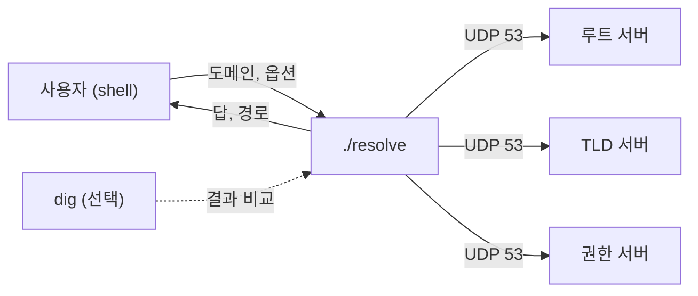

# DNS 리졸버 소프트웨어 요구사항 명세서 (SRS)

| 문서 | 버전 | 작성일 | 기준 표준 |
|------|------|--------|-----------|
| DNS 리졸버 SRS | 1.0 | 2026-11-18 | ISO/IEC/IEEE 29148:2018 |

## 1. 소개

### 1.1 목적

이 문서는 루트 네임서버부터 직접 반복 질의하는 DNS 리졸버 `./resolve`의 요구사항을 정의한다. 시스템 리졸버(`getaddrinfo` 등) 없이 DNS 패킷을 바이트 단위로 조립/파싱하고, `dig +short`와 같은 답과 루트부터 내려간 위임 경로를 출력하는 것이 목표다. 설계는 [SDS](SDS.md)에서 다룬다.

### 1.2 범위

`./resolve`가 하는 일:

- UDP로 DNS 질의 패킷을 직접 조립하고 응답을 직접 파싱한다
- 루트 힌트부터 시작해 TLD, 권한 서버 순으로 반복 질의한다
- 레코드 타입 A, AAAA, NS를 질의하고 CNAME을 따라간다
- glue 없는 위임에서 NS 이름을 따로 해석한다
- 받은 레코드를 TTL 동안 메모리에 캐시한다
- 위임 경로를 출력하고 NXDOMAIN/NODATA/타임아웃/truncation 에러를 구분한다
- 트랜잭션 ID가 다른 응답을 거부한다

하지 않는 일은 [부록 B](#부록-b-범위-외-항목)에 정리한다.

### 1.3 제품 개요

#### 1.3.1 제품 관점

`./resolve`는 단독 실행 CLI다. OS의 리졸버 경로(`getaddrinfo`, `/etc/hosts`, `resolv.conf`)를 거치지 않고 인터넷의 DNS 네임서버와 직접 UDP로 통신한다.

#### 1.3.2 제품 기능

- 질의 메시지 직렬화 (FR-1)
- 응답 메시지 파싱, 압축 포인터 처리 (FR-2)
- UDP 질의, 타임아웃, 재시도 (FR-3)
- 루트부터 반복 해석, glue 없는 위임 처리 (FR-4)
- CNAME 체이싱 (FR-5)
- TTL 캐시 (FR-6)
- CLI, 경로 출력, dig 일치 (FR-7)

#### 1.3.3 사용자 특성

| 사용자 | 특성 | 사용 상황 |
|--------|------|-----------|
| 개발자/학습자 | 셸과 DNS 기본 개념(도메인, IP)을 안다 | 도메인 하나가 루트 -> TLD -> 권한 서버로 어떻게 풀리는지 경로를 확인 |
| 코드 리뷰어 | C와 네트워크 프로토콜을 읽을 수 있다 | 바이너리 파싱(압축 포인터, 경계 검사)과 반복 질의 구현 검토 |

#### 1.3.4 제한 사항

| 항목 | 내용 |
|------|------|
| 언어 | C (Makefile 기준 `-std=c11`) |
| 의존성 | 외부 라이브러리 없음. POSIX 소켓/시간 API만 사용 |
| 플랫폼 | POSIX 환경 (`-D_POSIX_C_SOURCE=200809L -D_DARWIN_C_SOURCE`) |
| 실행 모델 | 단일 스레드, 단일 프로세스 |
| 네트워크 | 네임서버에 IPv4 UDP 포트 53으로 도달할 수 있어야 한다 |

### 1.4 용어 정의

| 용어 | 뜻 |
|------|----|
| 반복 질의 (iterative) | 리졸버가 루트부터 각 단계 서버에 직접 묻고, 받은 위임을 따라 내려가는 방식 (RFC 1034 §5.3.3). RD=0으로 질의 |
| 루트 힌트 | 루트 네임서버 IPv4 주소 목록. 소스에 하드코딩 |
| TLD | `.com`, `.org` 같은 최상위 도메인 |
| 권한 서버 (authoritative) | 해당 존의 레코드를 직접 가진 서버 |
| referral (위임) | "이 서버들에게 물어봐라"는 응답. authority 섹션에 NS, additional 섹션에 glue가 실린다 |
| glue | referral에 함께 실린 NS 이름의 A 레코드 (다음 서버 IP) |
| glue-less 위임 | glue 없이 NS 이름만 온 referral. NS 이름을 따로 해석해야 한다 |
| CNAME | 이름의 별칭. 답이 CNAME이면 타깃 이름으로 다시 해석한다 |
| 압축 포인터 | 앞에 나온 이름을 오프셋으로 가리키는 2바이트 값 (RFC 1035 §4.1.4) |
| TTL | 레코드를 캐시해도 되는 시간(초) |
| NXDOMAIN | 이름 자체가 없음 (RCODE 3) |
| NODATA | 이름은 있으나 요청 타입 레코드가 없음 (NOERROR + answer 0개) |
| TC | truncation 플래그. 응답이 512바이트에 맞게 잘렸음을 뜻한다 |
| ASan | AddressSanitizer. 버퍼 밖 접근을 실행 중에 잡는 컴파일러 기능 |

## 2. 참고 문서

| 문서 | 내용 |
|------|------|
| [SDS](SDS.md) | 설계 명세 (구성, 자료구조, 시퀀스, 알고리즘) |
| [README](../README.md) | 개요, 사용법, 실행 예 |
| RFC 1034 §5.3.3 | 리졸버 알고리즘 (반복 질의) |
| RFC 1035 §3.1, §3.2.2, §4, §4.1.1, §4.1.4 | 이름 표기, 레코드 타입, 메시지 포맷, 헤더, 압축 포인터 |
| RFC 3596 | AAAA 레코드 |
| IANA root hints (`named.root`) | 루트 서버 주소 출처 (`src/root_hints.c`) |

## 3. 요구사항

### 3.1 기능 요구사항

#### FR-1 DNS 질의 메시지 직렬화

| 설명 | 우선순위 | 출처 | 검증 방법 |
|------|----------|------|-----------|
| 시스템은 도메인 이름과 질의 타입(A/AAAA/NS)으로 RFC 1035 §4 질의 패킷(헤더 12바이트 + QNAME + QTYPE + QCLASS, RD=0)을 조립해야 한다 | 필수 | SPEC R1 | 시험 |

수용 기준:
- `example.com` A 질의 패킷의 바이트가 기대값과 일치한다
- 레이블 63바이트 초과 또는 전체 이름 255바이트 초과 입력을 에러로 거부한다
- 트랜잭션 ID가 매 질의마다 달라진다

#### FR-2 DNS 응답 메시지 파싱

| 설명 | 우선순위 | 출처 | 검증 방법 |
|------|----------|------|-----------|
| 시스템은 응답 패킷에서 헤더 플래그와 answer/authority/additional 섹션의 A/AAAA/NS/CNAME 레코드를 추출해야 한다. 모르는 타입은 RDLENGTH만큼 건너뛰고, 손상된 패킷은 크래시나 무한 루프 없이 에러로 처리해야 한다 | 필수 | SPEC R2 | 시험 |

수용 기준:
- 압축 포인터가 포함된 응답 패킷에서 이름이 올바르게 디코딩된다
- 포인터 루프 패킷에서 유한 시간 내 에러를 반환한다 (포인터는 현재 위치보다 앞쪽만 허용, 점프 상한 128)
- RDATA나 이름이 패킷 경계를 넘는 조작 패킷에서 에러를 반환한다
- 패킷을 길이 0부터 끝까지 잘라 가며 파싱해도 크래시가 없다

#### FR-3 UDP 질의와 신뢰성

| 설명 | 우선순위 | 출처 | 검증 방법 |
|------|----------|------|-----------|
| 시스템은 네임서버 IPv4 주소로 UDP 질의를 보내고, 타임아웃/재시도를 거쳐 검증된 응답을 받거나 구분된 에러 코드로 끝나야 한다. 실패 시 호출자가 다음 서버로 폴백할 수 있어야 한다 | 필수 | SPEC R3 | 시험, 시연 |

수용 기준:
- 네임서버에 단발 질의를 보내 파싱된 응답을 받는다
- 트랜잭션 ID가 다른 응답은 폐기하고 데드라인까지 계속 대기한다
- 무응답 IP(예: 192.0.2.1)에 질의하면 3초 x 2회 이내에 타임아웃 에러를 반환한다

#### FR-4 루트부터 반복 해석

| 설명 | 우선순위 | 출처 | 검증 방법 |
|------|----------|------|-----------|
| 시스템은 루트 힌트에서 시작해 referral을 따라 A/AAAA/NS를 해석하고 각 단계를 경로로 기록해야 한다. glue가 없으면 NS 이름을 따로 해석하고, 한 존의 서버가 전부 실패하면 에러로 끝나야 한다 | 필수 | SPEC R4 | 시연, 시험 |

수용 기준:
- `./resolve example.com`이 루트 -> com -> 권한 서버 위임을 거쳐 A 레코드를 출력한다
- glue 없는 위임을 가진 도메인이 해석되고, NS 별도 해석 단계가 경로에 보인다
- RCODE 3이면 `NXDOMAIN`, NOERROR + answer 0개면 `NODATA`를 출력하고 비0 종료한다
- 최종 답이 TC=1이면 부분 답을 쓰지 않고 truncation 에러로 비0 종료한다
- 존재하지 않는 TLD(예: `foo.invalidtld12345`) 질의가 유한 시간 내 에러로 끝난다

#### FR-5 CNAME 체이싱

| 설명 | 우선순위 | 출처 | 검증 방법 |
|------|----------|------|-----------|
| 시스템은 답이 CNAME이면 타깃 이름으로 해석을 이어가 최종 A/AAAA에 도달해야 한다. 같은 응답에 타깃 레코드가 있으면 추가 질의 없이 쓰고, 체인 상한 8을 넘으면 에러로 끝나야 한다 | 필수 | SPEC R5 | 시연, 시험 |

수용 기준:
- CNAME을 가진 실제 도메인이 최종 IP까지 해석되고 경로에 CNAME 단계가 보인다
- 체인 9 이상 또는 루프면 `CNAME chain too long` 에러로 끝난다

#### FR-6 TTL 기반 캐시

| 설명 | 우선순위 | 출처 | 검증 방법 |
|------|----------|------|-----------|
| 시스템은 해석 중 받은 A/AAAA/NS/CNAME 레코드를 TTL 동안 메모리에 저장해야 한다. 캐시 히트 시 네트워크 질의를 생략하고, 다음 해석은 캐시된 가장 가까운 위임 존에서 시작해야 한다 | 필수 | SPEC R6 | 시험, 시연 |

수용 기준:
- `./resolve -v a.example.com b.example.com`에서 두 번째 해석의 루트/TLD 질의가 생략됨이 로그로 보인다
- 같은 도메인을 두 번 넘기면 두 번째는 네트워크 질의 0회로 캐시에서 답한다
- TTL 0 레코드는 캐시되지 않는다
- 만료된 엔트리는 반환되지 않는다

#### FR-7 CLI, 경로 출력, dig 일치

| 설명 | 우선순위 | 출처 | 검증 방법 |
|------|----------|------|-----------|
| 시스템은 `./resolve [-t A\|AAAA\|NS] [-v] <domain> [<domain>...]`로 실행되어, 최종 레코드를 `dig +short`와 같은 집합으로 출력하고 위임 경로를 단계당 한 줄로 출력해야 한다 | 필수 | SPEC R7 | 시험, 시연 |

수용 기준:
- 고정 도메인 목록에서 `./resolve <d>`의 IP 집합이 `dig +short <d>`와 순서 무관 일치한다
- `-t AAAA`, `-t NS` 결과가 각각 dig와 집합 일치한다
- 경로 출력에 루트, TLD, 권한 서버 단계가 각각 최소 한 줄씩 나타난다
- 인자 없음 또는 잘못된 `-t` 값이면 usage를 출력하고 비0 종료한다

### 3.2 성능 요구사항

| ID | 요구사항 | 목표치 | 검증 방법 |
|----|----------|--------|-----------|
| NFR-1 | 서버 하나에 대한 질의는 유한 시간 안에 끝나야 한다 | 시도당 3초 타임아웃, 재시도 1회 (서버당 최대 6초) | 시험 |
| NFR-2 | 어떤 입력 패킷도 파싱이 유한 시간에 끝나야 한다 | 압축 포인터 점프 상한 128, 앞쪽 오프셋만 허용 | 시험 |
| NFR-3 | 해석 루프가 무한히 돌지 않아야 한다 | CNAME 체인 8, glue-less NS 재귀 깊이 8, 위임 홉 32 | 시험, 검사 |

### 3.3 사용성 요구사항

| ID | 요구사항 |
|----|----------|
| US-1 | 답은 `dig +short` 형식(한 줄에 레코드 하나)이라 다른 도구와 비교하거나 파이프로 넘기기 쉬워야 한다 |
| US-2 | 위임 경로는 단계마다 "어느 서버에 무엇을 물었고 무엇을 받았는가"가 한 줄로 드러나야 한다 |
| US-3 | `-v`로 모든 네트워크 질의와 캐시 동작을 관찰할 수 있어야 한다 |

### 3.4 인터페이스 요구사항

사용자 인터페이스:

| ID | 요구사항 |
|----|----------|
| IF-1 | CLI 형식은 `./resolve [-t A\|AAAA\|NS] [-v] <domain> [<domain>...]`이며 기본 타입은 A다 |
| IF-2 | 최종 레코드는 stdout에, 경로/에러/verbose 로그는 stderr에 출력한다 |
| IF-3 | 종료 코드: 모든 도메인 해석 성공 0, 해석 실패 1, 사용법 오류 2 |

소프트웨어 인터페이스:

| 대상 | 내용 |
|------|------|
| OS API | POSIX `socket`, `sendto`, `recvfrom`, `select`, `inet_pton`, `inet_ntop`, `gettimeofday`, `time` |
| 시스템 리졸버 | 사용하지 않음 (금지 조건 MN-1) |
| `dig` | `tests/compare_dig.sh`에서만 비교 기준으로 사용 (선택) |

통신 인터페이스:

| ID | 요구사항 |
|----|----------|
| IF-4 | 네임서버와 IPv4 UDP 포트 53으로 RFC 1035 와이어 포맷 메시지를 주고받는다. 송수신 버퍼 512바이트, RD=0 |

### 3.5 논리 데이터 요구사항

| 데이터 | 보존 범위 | 내용 |
|--------|-----------|------|
| 레코드 캐시 | 프로세스 수명 동안 메모리에만 | (이름, 타입) 키, 레코드 값, 절대 만료 시각. A/AAAA/NS/CNAME만 |
| 위임 경로 로그 | 도메인 하나 해석 동안 | 단계별 한 줄 텍스트 |
| 루트 힌트 | 소스 상수 | 루트 서버 이름과 IPv4 주소 |

디스크에 저장하는 데이터는 없다. 상세 자료구조는 [SDS 3.4](SDS.md#34-정보-뷰)에 있다.

### 3.6 설계 제약

- 외부 라이브러리와 시스템 리졸버 함수를 쓰지 않는다
- 질의 트랜스포트는 IPv4 UDP만 쓴다. EDNS0 없이 512바이트 버퍼를 쓴다
- 단일 스레드, 단일 프로세스로 동작한다
- 루트 힌트는 소스에 하드코딩한다 (루트 서버 IPv4 4개 이상, 현재 8개)
- 상한값: 압축 포인터 점프 128, CNAME 체인 8, glue-less NS 재귀 깊이 8
- 타임아웃 3초, 서버당 재시도 1회, 존 안에서 다음 NS로 폴백

### 3.7 소프트웨어 시스템 속성

| ID | 분류 | 요구사항 | 목표치 |
|----|------|----------|--------|
| NFR-4 | 보안 | 어떤 입력 패킷에도 패킷 버퍼 밖을 읽지 않아야 한다 | 모든 읽기 경계 검사, 단위 테스트를 ASan으로 빌드 |
| NFR-5 | 보안 | 트랜잭션 ID가 다른 응답을 받아들이지 않아야 한다 | 불일치 응답 폐기 |
| NFR-6 | 이식성 | 표준 C와 POSIX API만으로 빌드되어야 한다 | `-std=c11 -Wall -Wextra` 빌드 성공 |
| NFR-7 | 유지보수성 | 파싱, 캐시, CNAME 종료를 네트워크 없이 시험할 수 있어야 한다 | `make test` 단위 테스트 3종 |

### 3.8 금지 조건 (must-NOT)

| ID | 금지 조건 |
|----|-----------|
| MN-1 | `getaddrinfo`, `gethostbyname`, `res_query` 등 시스템 리졸버 호출이 소스 어디에도 없다 |
| MN-2 | TTL이 만료된 캐시 엔트리를 답으로 반환하지 않는다 |
| MN-3 | 트랜잭션 ID가 일치하지 않는 응답을 수용하지 않는다 |
| MN-4 | TC=1 응답의 부분 답을 최종 답으로 출력하지 않는다 |
| MN-5 | 어떤 입력 패킷에도 패킷 버퍼 밖을 읽지 않는다 |

## 4. 검증

### 4.1 검증 방법

| 방법 | 수단 | 실행 |
|------|------|------|
| 시험 (단위) | `tests/test_message.c` (16 checks), `tests/test_cache.c` (7 checks), ASan 빌드 | `make test` |
| 시험 (오프라인 통합) | `tests/test_cname.c` (4 checks). 캐시에 레코드를 심고 네트워크 없이 `resolve()` 실행 | `make test` |
| 시험 (실망 비교) | `tests/compare_dig.sh`. A/AAAA/NS 결과 집합을 `dig +short`와 비교 | `make && bash tests/compare_dig.sh` |
| 시연 | README에 실린 실제 실행 출력 (`./resolve example.com`, `./resolve www.iana.org`) | `./resolve <domain>` |
| 검사 | 소스 grep, 코드 확인 | `grep -rnE "getaddrinfo\|gethostbyname\|res_query" src/` |

`make test`는 현재 3종 모두 ALL PASS다. `compare_dig.sh`는 저장된 실행 결과가 없다.

### 4.2 요구사항 추적표

| ID | 요구사항 | 구현 위치 | 검증 근거 | 상태 |
|----|----------|-----------|-----------|------|
| FR-1.1 | example.com A 질의 바이트 일치 | `src/dns_encode.c` | `tests/test_message.c` `test_encode_query` | 충족 |
| FR-1.2 | 레이블 63 / 이름 255 초과 거부 | `src/dns_encode.c` | `tests/test_message.c` `test_encode_limits` | 충족 |
| FR-1.3 | 질의마다 다른 트랜잭션 ID | `src/dns_query.c` `random_id` | 전용 테스트 없음 | 미검증 |
| FR-2.1 | 압축 포인터 이름 디코딩 | `src/dns_decode.c` | `tests/test_message.c` `test_decode_good` (직접 만든 패킷) | 충족 |
| FR-2.2 | 포인터 루프 유한 종료 | `src/dns_decode.c` `dns_decode_name` | `tests/test_message.c` `test_decode_pointer_loop`, `test_decode_forward_pointer` | 충족 |
| FR-2.3 | 경계 초과 패킷 에러 | `src/dns_decode.c` `parse_rr` | `tests/test_message.c` `test_decode_rdata_overflow` | 충족 |
| FR-2.4 | 절단 반복 파싱 무크래시 | `src/dns_decode.c` | `tests/test_message.c` `test_decode_truncation_fuzz` (ASan) | 충족 |
| FR-3.1 | 단발 UDP 질의 응답 수신 | `src/dns_query.c` `query_server` | README 실행 예 (각 홉이 응답을 받음) | 충족 |
| FR-3.2 | ID 불일치 응답 폐기 후 대기 | `src/dns_query.c` `query_once` | 전용 테스트 없음 | 미검증 |
| FR-3.3 | 무응답 IP 6초 이내 타임아웃 | `src/dns_query.c` | 전용 테스트 없음 | 미검증 |
| FR-4.1 | 루트 -> com -> 권한 서버 해석 | `src/resolve.c` `iterative_lookup` | README 실행 예 `./resolve example.com` | 충족 |
| FR-4.2 | glue 없는 위임 해석 | `src/resolve.c` `resolve_ns_ip` | 테스트와 실행 기록 없음 | 미검증 |
| FR-4.3 | NXDOMAIN / NODATA 구분, 비0 종료 | `src/resolve.c`, `src/main.c` | 테스트와 실행 기록 없음 | 미검증 |
| FR-4.4 | TC=1 최종 답 에러 | `src/resolve.c` `iterative_lookup` | 테스트와 실행 기록 없음 | 미검증 |
| FR-4.5 | 없는 TLD 유한 종료 | `src/resolve.c` | 테스트와 실행 기록 없음 | 미검증 |
| FR-5.1 | 실제 CNAME 도메인 해석 | `src/resolve.c` `resolve` | README 실행 예 `./resolve www.iana.org` | 충족 |
| FR-5.2 | 체인 9 이상 / 루프 에러 | `src/resolve.c` `resolve` | `tests/test_cname.c` (a.test <-> b.test 루프) | 충족 |
| FR-6.1 | 두 번째 도메인 루트/TLD 생략 | `src/resolve.c` `servers_from_cache` | 테스트와 실행 기록 없음 | 미검증 |
| FR-6.2 | 같은 도메인 재질의 네트워크 0회 | `src/resolve.c` `resolve` | 테스트와 실행 기록 없음 | 미검증 |
| FR-6.3 | TTL 0 미저장 | `src/cache.c` `cache_put_at` | `tests/test_cache.c` | 충족 |
| FR-6.4 | 만료 엔트리 미반환 | `src/cache.c` `cache_get_at` | `tests/test_cache.c` | 충족 |
| FR-7.1 | A 결과 dig 집합 일치 | `src/main.c` | `tests/compare_dig.sh` 존재, 저장된 실행 결과 없음 | 미검증 |
| FR-7.2 | AAAA / NS 결과 dig 집합 일치 | `src/main.c` | `tests/compare_dig.sh` 존재, 저장된 실행 결과 없음 | 미검증 |
| FR-7.3 | 경로에 루트/TLD/권한 단계 | `src/resolve.c` `path_add`, `src/main.c` | README 실행 예 | 충족 |
| FR-7.4 | 잘못된 인자 usage + 비0 종료 | `src/main.c` `usage` | 테스트와 실행 기록 없음 | 미검증 |
| NFR-1 | 질의 유한 시간 종료 | `src/dns_query.c` | 전용 테스트 없음 | 미검증 |
| NFR-2 | 파싱 유한 종료 | `src/dns_decode.c` | `tests/test_message.c` `test_decode_pointer_loop` | 충족 |
| NFR-3 | 해석 루프 상한 | `src/resolve.c` | CNAME 상한만 `tests/test_cname.c`로 확인, NS 깊이/위임 홉 상한은 테스트 없음 | 미검증 |
| NFR-4 | 버퍼 밖 읽기 없음 | `src/dns_decode.c` | `tests/test_message.c` (ASan) | 충족 |
| NFR-5 | ID 불일치 응답 폐기 | `src/dns_query.c` | 전용 테스트 없음 | 미검증 |
| NFR-6 | C11 + POSIX 빌드 | `Makefile` | `make`, `make test` 빌드 성공 | 충족 |
| NFR-7 | 네트워크 없는 단위 테스트 | `tests/`, `Makefile` | `make test` 3종 ALL PASS | 충족 |
| US-1 | `dig +short` 형식 답 | `src/main.c` `print_record` | README 실행 예 | 충족 |
| US-2 | 단계당 한 줄 경로 | `src/resolve.c` `path_add` | README 실행 예 | 충족 |
| US-3 | `-v` 관찰 로그 | `src/dns_query.c`, `src/resolve.c` | 테스트와 실행 기록 없음 | 미검증 |
| IF-1 | CLI 형식 | `src/main.c` | 테스트 없음 | 미검증 |
| IF-2 | stdout / stderr 분리 | `src/main.c` | 테스트 없음 | 미검증 |
| IF-3 | 종료 코드 0 / 1 / 2 | `src/main.c` | 테스트 없음 | 미검증 |
| IF-4 | IPv4 UDP 53, RFC 1035 포맷 | `src/dns_query.c`, `src/dns_encode.c` | `tests/test_message.c` (포맷), README 실행 예 (실제 통신) | 충족 |
| MN-1 | 시스템 리졸버 호출 없음 | `src/` 전체 | `grep -rnE "getaddrinfo\|gethostbyname\|res_query" src/` 0건 | 충족 |
| MN-2 | 만료 캐시 미반환 | `src/cache.c` | `tests/test_cache.c` | 충족 |
| MN-3 | ID 불일치 응답 미수용 | `src/dns_query.c` | 전용 테스트 없음 | 미검증 |
| MN-4 | TC=1 부분 답 미출력 | `src/resolve.c` | 테스트와 실행 기록 없음 | 미검증 |
| MN-5 | 패킷 버퍼 밖 읽기 없음 | `src/dns_decode.c` | `tests/test_message.c` 절단 fuzz + ASan | 충족 |

## 부록 A. 가정과 의존성

| 항목 | 내용 |
|------|------|
| 루트 서버 주소 | `src/root_hints.c`의 IPv4 주소가 유효하다고 가정한다 (수십 년 단위로 안정적) |
| 네트워크 | 실행 환경에서 외부 IPv4 UDP 포트 53이 막혀 있지 않다고 가정한다 |
| 응답 크기 | referral 응답은 512바이트에 맞게 레코드 수를 줄여 보내며, 실린 레코드는 각각 완전하다고 가정한다 |
| dig 비교 | `tests/compare_dig.sh`는 고정 도메인의 레코드 집합이 안정적이라고 가정한다. `dig`가 없으면 SKIP |
| 빌드 도구 | `cc`(`CC` 변수로 변경 가능)와 `make`. ASan을 지원하는 컴파일러 |

## 부록 B. 범위 외 항목

| 항목 | 이유 |
|------|------|
| EDNS0 | 512바이트 제한 완화가 목적이며 핵심 기능(파싱, 반복 질의)과 무관 |
| TCP 폴백 | TC=1 최종 답은 에러 처리로 충분 |
| DNSSEC | 검증 로직이 별도 프로젝트 분량 |
| PTR, MX, TXT 등 기타 타입 | 파싱 구조가 같아 추가 가치가 적음 |
| 캐시 포이즈닝 방어 (소스 포트 랜덤화, 0x20 인코딩) | 보안 목적 프로젝트가 아님. 트랜잭션 ID 검증만 범위 내 |
| `/etc/hosts`, `resolv.conf` 참조 | 시스템 리졸버 경로를 일부러 우회하는 프로젝트이므로 모순 |
| 멀티스레드, 데몬화, 영속 캐시 | 단일 프로세스 CLI 범위를 넘음 |
| IPv6 트랜스포트 | AAAA 레코드 파싱은 하되 질의는 IPv4 UDP로만 |
